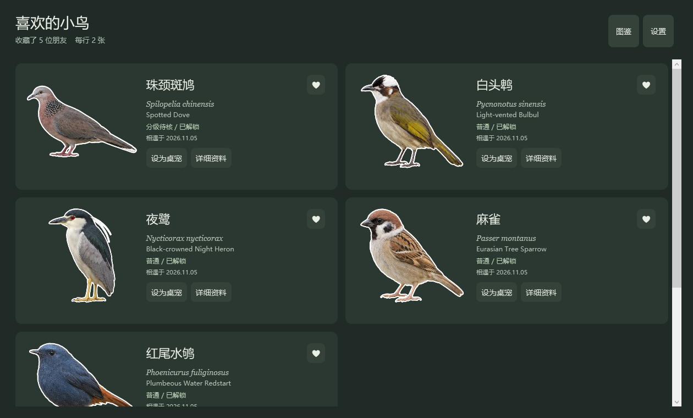

# 窗边小鸟 · Window Bird Companion

温馨简约的 Windows 观鸟桌宠，欣赏鸟类贴纸、查阅图鉴，随陪伴时间逐步收集小鸟。

## 直接运行

支持 **Windows 10/11 x64**。本仓库已经包含 **1.2.0 自包含程序、.NET 运行时和全部鸟类资源**，无需安装 .NET、Python、Node.js、Git LFS 或编译工具，运行时不需要联网。

1. 克隆本仓库，或通过 GitHub 的 **Code → Download ZIP** 下载并解压完整目录。
2. 双击根目录 **启动观鸟桌宠.cmd**（或 `Start.cmd`）。也可直接运行 `runtime/BirdCompanion.exe`。
3. 小鸟出现在桌面，系统托盘提供显示/隐藏、设置、图鉴和退出。

请保留目录结构，不要单独复制 EXE。新用户从初始四种开始，仓库不含作者的个人进度。升级时先从托盘退出旧实例，再启动新版。

## 功能与操作

- **单击**鸟图查看简介，再次单击空白处返回；拖动移动，**Ctrl + 滚轮**等比缩放。
- 悬停显示中文名、学名和工具栏；支持前后切换、随机选鸟，切换时平滑渐变并展示姓名 2 秒。
- 图鉴包含 11,011 种鸟的记录，支持搜索、分类、排序和完整资料；未解锁项不展示贴纸。
- 点名字旁的 **♡ / ♥** 收藏或取消收藏，收藏页按卡片网格排列，每行可选 1–4 张。
- 设置支持浅深主题、置顶、按钮框透明度、定时随机切换、随机范围（全部已解锁/收藏）、自动开箱。
- **全屏免打扰默认开启**：前台其他应用全屏时自动隐藏桌宠，结束后恢复；设置可关闭。
- 连续 3 秒内点击工具栏设置按钮 5 次，出现开发者区域，可解锁全部可收藏鸟种或重置初始四种。

## 宝箱与进度

初始解锁：珠颈斑鸠、白头鹎、夜鹭、麻雀。

- 少于 50 种：有效运行每 **10 分钟**获得一箱。
- 恰好 50 种：每 **30 分钟**一箱。
- 超过 50 种：设置开放自定义间隔，默认 **30 分钟**，支持 0.1–10080 分钟。
- 改变间隔或跨门槛时按比例保留当前箱进度。睡眠、休眠和退出不累计，宝箱可积存。
- 每箱三选一：70% 解锁 5 种普通鸟、25% 解锁 2 种稀有鸟、5% 解锁 1 种极其稀有鸟；不重复，耗尽奖池会调整。

存档位于 `%LOCALAPPDATA%\WindowBirdCompanion\progress.json`，自动保留备份。游戏稀有度依据资源快照分级，不等同于实时保护信息或本地观察难度；缺图、待核和部分灭绝记录不加入首版奖池。

## 目录

- `runtime/`：直接运行的 Windows x64 成品和第三方运行时许可。
- `huashu-bird-sticker/`：完整原始贴纸、数据、来源和许可（不含嵌套 Git 仓库）。
- `app/`、`tests/`、`tools/`：应用源码、回归测试及资源辅助工具。
- `build.ps1`：供开发者重建运行程序，开发时需要 .NET 8 SDK；普通使用者无需执行。

## 许可与致谢

应用自有源码使用 [MIT](LICENSE) 许可。**MIT 不覆盖以下第三方素材与组件**：

- 鸟类贴纸来自 [花叔 huashu-bird-sticker](https://github.com/alchaincyf/huashu-bird-sticker)，贴纸为 **CC BY 4.0**，原始 WebP 未修改；资源固定提交 `5ed59e2fa1c466348da721b82786fc2bd7b0f831`。红尾水鸲图标由同一原贴纸等比例生成。
- 中文图鉴文字为 **CC BY-SA 4.0**；数据及第三方分类、鸟名、形态生态信息保留各自许可，详见 [资源许可](huashu-bird-sticker/LICENSE.md) 与 [来源说明](huashu-bird-sticker/NOTICE.md)。
- .NET、SkiaSharp 等组件的许可保存在 `runtime/licenses/`；另见 [第三方说明](THIRD-PARTY-NOTICES.md)。

鸟图为 AI 插画，适合欣赏与知识浏览，精细辨识请核对可靠图鉴。

